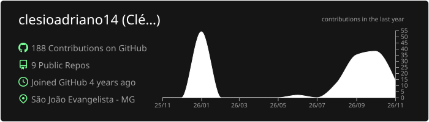
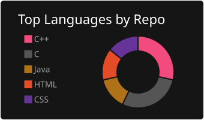
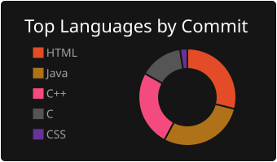
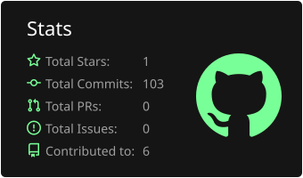
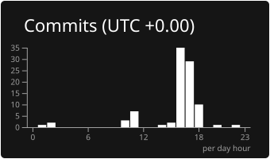

<h1 align="center">
  
</h1>

---

Olá, me chamo **Clésio Adriano de Carvalho Filho**, tenho 24 anos e resido em São João Evangelista, Minas Gerais. Atualmente, estou cursando o 6° período em Sistemas de Informação no IFMG - Campus São João Evangelista.

Utilizo este GitHub para armazenar projetos e registrar minha evolução acadêmica e profissional. Tenho um forte foco no desenvolvimento de software e sistemas, interligando linguagens de programação (C, C++, Java, Python e C#) com o desenvolvimento de projetos práticos e investigação acadêmica.

---

### 🤝 Conecte-se comigo!

  
  
  

 

💻 Tecnologias

<!-- Linguagens de programação -->

<!--

-->

<!--

<!-- Desenvolvimento Web -->

<!--

<!-- Bancos de dados -->

<!-- Desenvolvimento Mobile 

-->
<!-- Ferramentas e versionamento -->

<!--

-->

<!--

-->

<!-- DevOps, Containers e Cloud -->

<!--

-->

<!-- Data Science e Inteligência Artificial -->

 

### 📊 Estatísticas

 
 

